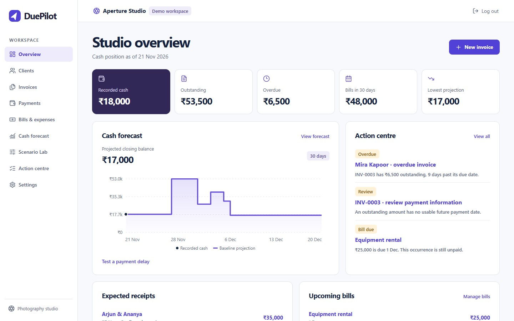
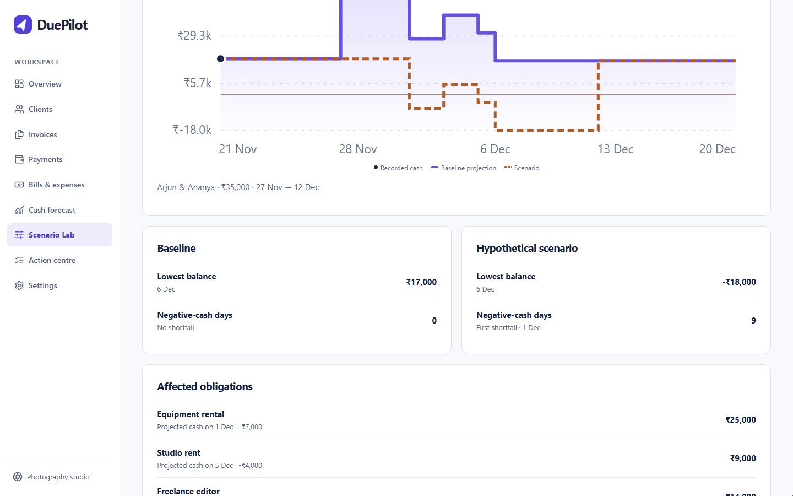
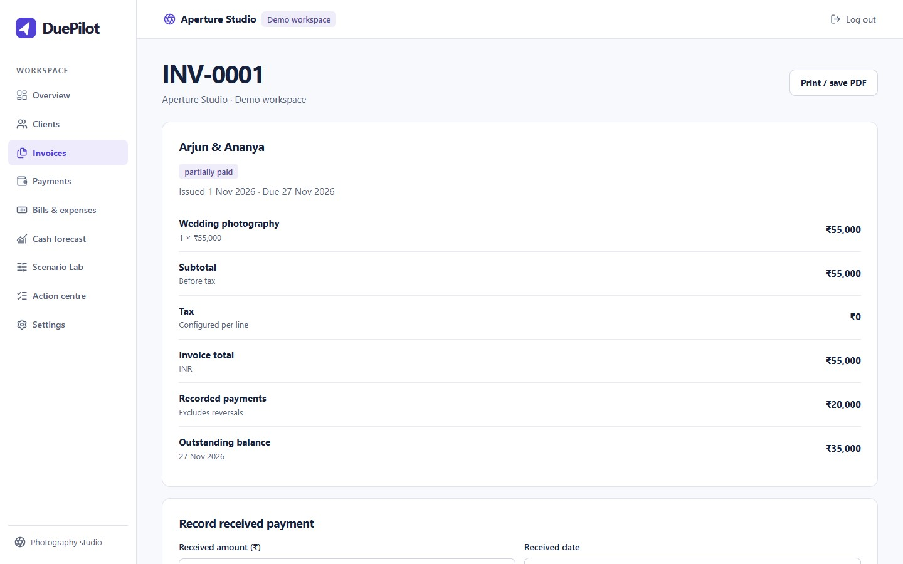
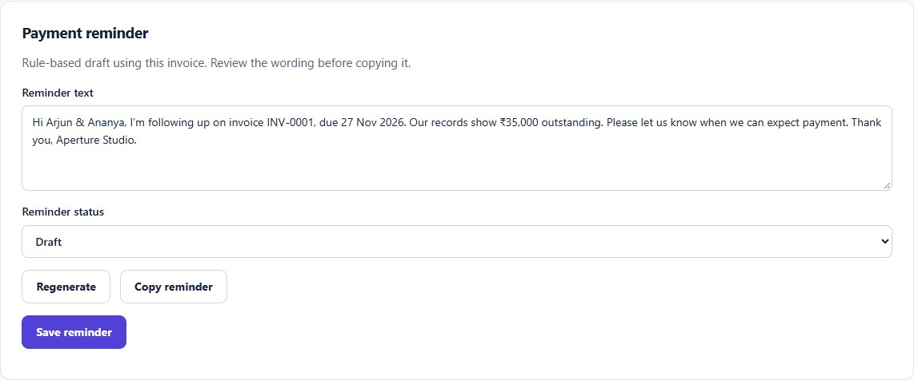

# DuePilot

**Know your cash before your clients pay.**

DuePilot helps independent Indian wedding photographers and small studios see whether expected payments will cover their next bills. Track invoices and receipts, model a delay and prepare a client follow-up before cash runs short.

**ACE Builders Hackathon 2026 · The One-Person Back Office**

[Open DuePilot](https://duepilot-studio-ace.vercel.app/) · [Three-minute judge walkthrough](docs/DEMO_SCRIPT.md) · [Architecture and data model](docs/ARCHITECTURE.md) · [Verification record](docs/TEST_RESULTS.md)

## One late payment changes the month

In the live demo, Aperture Studio expects a ₹35,000 payment from Arjun & Ananya on 27 November. It has ₹25,000 in equipment rental due on 1 December. Move the expected receipt to 12 December to see the impact on the same ledger.

| Scenario Lab result | Baseline | Receipt delayed by 15 days |
| --- | ---: | ---: |
| Lowest projected cash | ₹17,000 | −₹18,000 |
| First shortfall | None | 1 December |
| Days ending below zero | 0 | 9 |

The dashboard, scenario and invoice below are captured from the deployed app using fictional demo data. Scenarios leave the recorded invoice and payment history intact.

## Try the demonstration

1. Choose **Explore live demo**. Aperture Studio opens with ₹18,000 in opening cash and a planning date of 21 November 2026.
2. Open **Scenario Lab** and select **Delay by 15 days** for Arjun & Ananya.
3. Review the affected bills and select **Prepare a client follow-up**. DuePilot pre-fills a reminder you can edit and copy.
4. Use **Reset scenario** to return to the baseline. Studio settings can restore all sample records.

See the invoice and editable reminder

## Working features

- Signup, login, logout, expiring database-backed sessions and business onboarding.
- Client profiles, notes, archiving, project associations, invoice and receipt history.
- Searchable invoices with itemized drafts, fractional quantities, per-line tax, milestones, issuance, disputes and printable PDF output.
- Confirmed partial or full receipts, targeted invoice payments, optional oldest-due-first client allocation, duplicate submission protection and audited reversals.
- Bills, weekly and monthly recurrence, payment of individual occurrences and actual cash outflows.
- Daily forecasts over 30, 60 or 90 days, recorded cash, missing dates, dated assumptions, negative days and affected obligations.
- Interactive receipt delays and hypothetical expense changes, named scenarios, and baseline comparison.
- Linked alerts, dismiss/resolve controls, editable rule-based reminders, clipboard copying and manual-send tracking.
- Note parsing with owner confirmation, superseded promise history, source text and a correction/rejection trail.
- Business profile, optional logo, horizon and due-date policy, scoped JSON data export, isolated demo reset and responsive navigation.

## Stack and storage

Next.js App Router, React, TypeScript and Tailwind run as one application. Drizzle and parameterized PostgreSQL queries access the same database. The production deployment uses Vercel and Neon PostgreSQL. Session tokens are random, stored as hashes, and carried in HTTP-only cookies. Same-origin checks protect writes. PostgreSQL enforces foreign keys and per-business invoice and payment-key uniqueness. Locks, transactions and audit entries protect financial updates. [Architecture and file map](docs/ARCHITECTURE.md)

## Local installation

Use Node.js 22, npm and a PostgreSQL database. Run from the project root.

1. Run `npm ci`.
2. Copy `.env.example` to `.env.local`. Set `DATABASE_URL` to your PostgreSQL connection string. For remote PostgreSQL use verified TLS. Set `SESSION_SECRET` to a random secret of at least 32 characters and `APP_URL` to the exact browser origin.
3. Apply pending migrations with `npm run db:migrate`. For a schema change, edit `lib/db/schema.ts`, run `npm run db:generate`, review the generated SQL, and then migrate. Keep applied migrations immutable.
4. Run `npm run dev` and open `http://localhost:3000`. For a production-mode local run, use `npm run build` followed by `npm start`. A different port must also be reflected in `APP_URL`.

The existing Windows checkout uses the standard local origin on port 3000. Its original `.env` remains in place. Its PostgreSQL endpoint on loopback refused connections during this build. The ignored `.env.local` selects the new DuePilot PostgreSQL database for this checkout.

## Tests

| Command | Scope |
| --- | --- |
| `npm run typecheck` | TypeScript |
| `npm run lint` | Next.js ESLint rules |
| `npm test` | Vitest financial rules, auth, database transactions and tenant isolation |
| `npm run build` | Production compilation, route build and checks |
| `npm run test:e2e` | Browser journeys and API checks against a running server |
| `npm audit --omit=dev` | Production dependency advisory check |

Database tests use isolated application fixtures. Browser tests create synthetic accounts and demo studios. After a production build, Playwright starts or reuses the local server on port 3000 and runs installed Chrome. Set `TEST_BASE_URL` to verify a deployed origin. With Playwright-managed Chromium, install its browser and set `PLAYWRIGHT_CHANNEL=chromium`. [Verification evidence](docs/TEST_RESULTS.md)

## Deployment

1. Provision a dedicated PostgreSQL database and a Vercel project using the Next.js preset and Node 22. Set the runtime region near the database.
2. Set production `DATABASE_URL`, `SESSION_SECRET` and `APP_URL` using the hosting provider's environment configuration. Use the stable production URL for `APP_URL`. Keep real values out of version control.
3. Run the migrations against the target database. Build and deploy the repository with `vercel deploy --prod` or an authorized repository integration.
4. Open the stable public URL. Check signup, logout and re-login persistence, the private demo, the 15-day scenario and an unauthenticated request to `/api/studio`. The latter must return HTTP 401.

## Financial assumptions and limits

A promise changes an expected receipt. Only an explicitly recorded receipt increases cash. Each projection uses unpaid amounts and the configured policy. Overdue amounts without a revised date and disputed invoices are listed separately. The model uses daily closing balances and does not predict the likelihood of payment. [Forecast methodology](docs/FORECAST_METHODOLOGY.md)

- Reminders, note parsing and explanations use deterministic rules. Relative dates require an explicit owner choice. The app has no configured LLM, email delivery, bank feed, payment processor or tax filing service.
- Browser print provides invoice PDF output. The current account flow supports signup and login. Email verification and password recovery are outside this release.
- Designed for one owner per studio and modest studio-sized data volumes. The forecast reads the studio ledger into a consistent snapshot. There is no automatic reconciliation or multi-currency conversion.
- Current planning currency is INR and the time zone is Asia/Kolkata. The sample calendar is fixed so the judge walkthrough remains reproducible.

## Commercial model

The pricing hypothesis is ₹299/month for a solo photographer on Starter, ₹799/month for a small studio on Studio, and custom Partner pricing for creative teams. The proposed value is less manual follow-up and earlier visibility of shortfalls. Billing is outside this release.

## Third-party licensing

Next.js, React, React DOM, pg, Zod, Tailwind, PostCSS, Autoprefixer, esbuild, the TypeScript definition packages, ESLint, its Next.js configuration, Drizzle Kit, tsx and Vitest use MIT licences. Drizzle ORM, TypeScript and Playwright use Apache-2.0. bcryptjs uses BSD-3-Clause. Lucide React uses ISC. Version pins and transitive dependencies are recorded in `package-lock.json`. The chart renderer and sample data are authored for this project. [Build history and environment evidence](docs/CODEBENDERS_BUILD_LOG.md)
